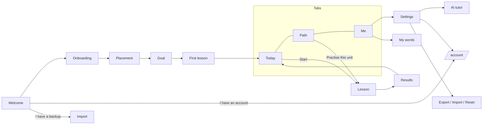
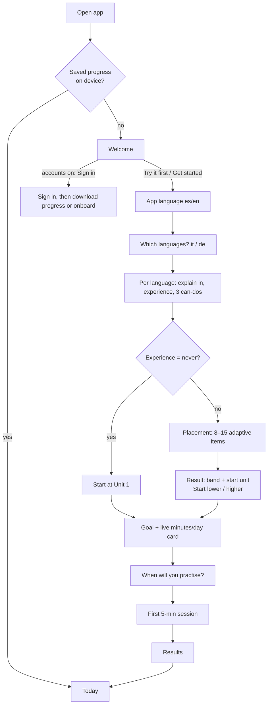
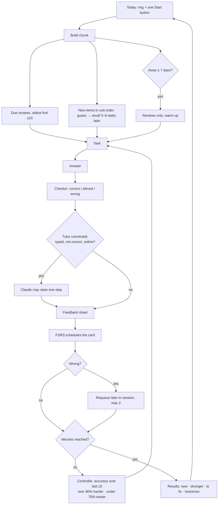
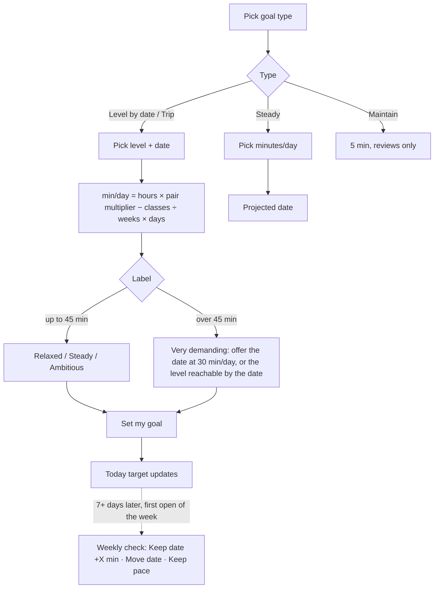
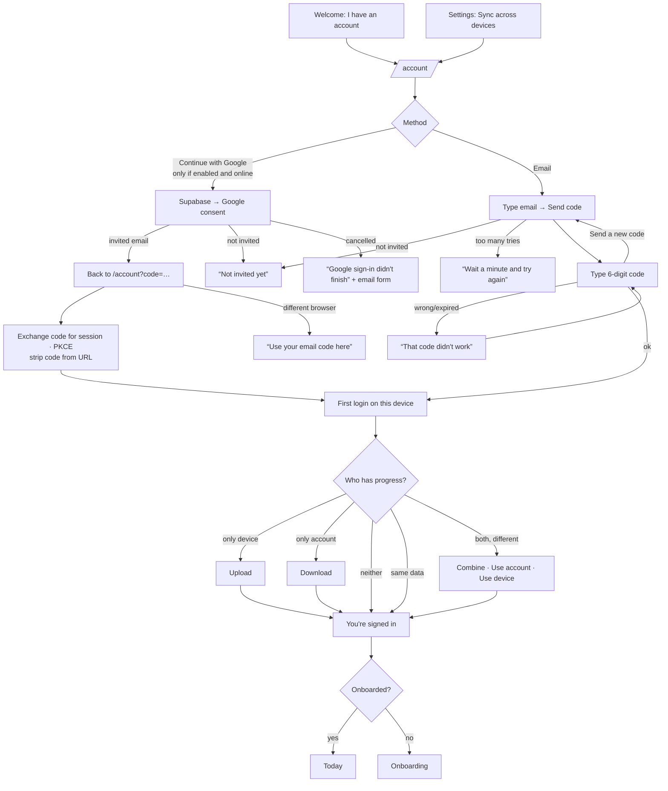
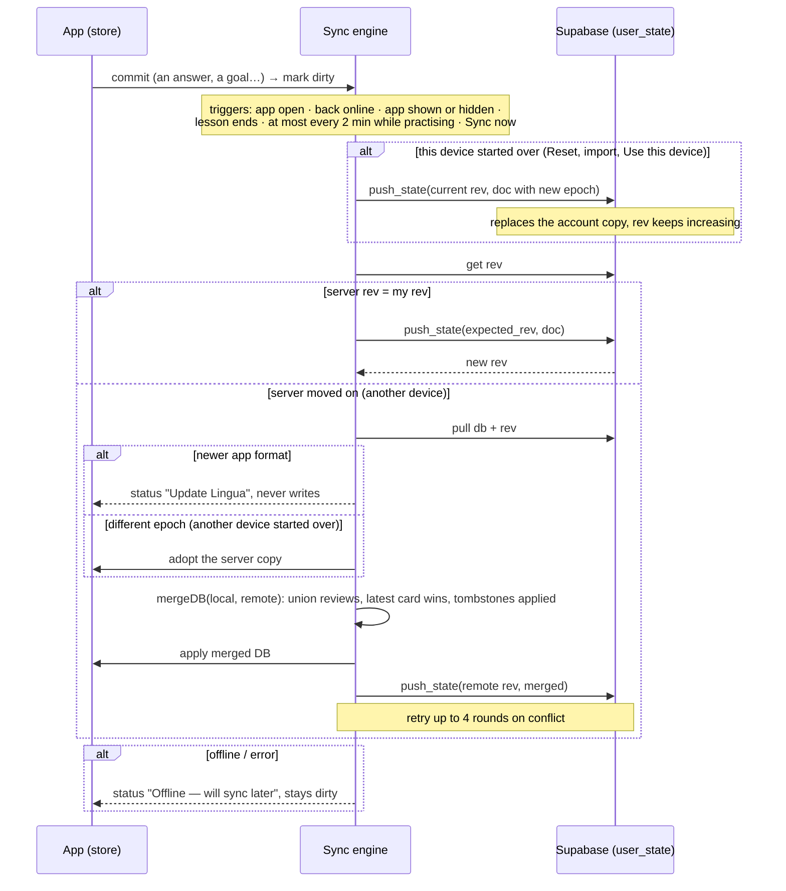
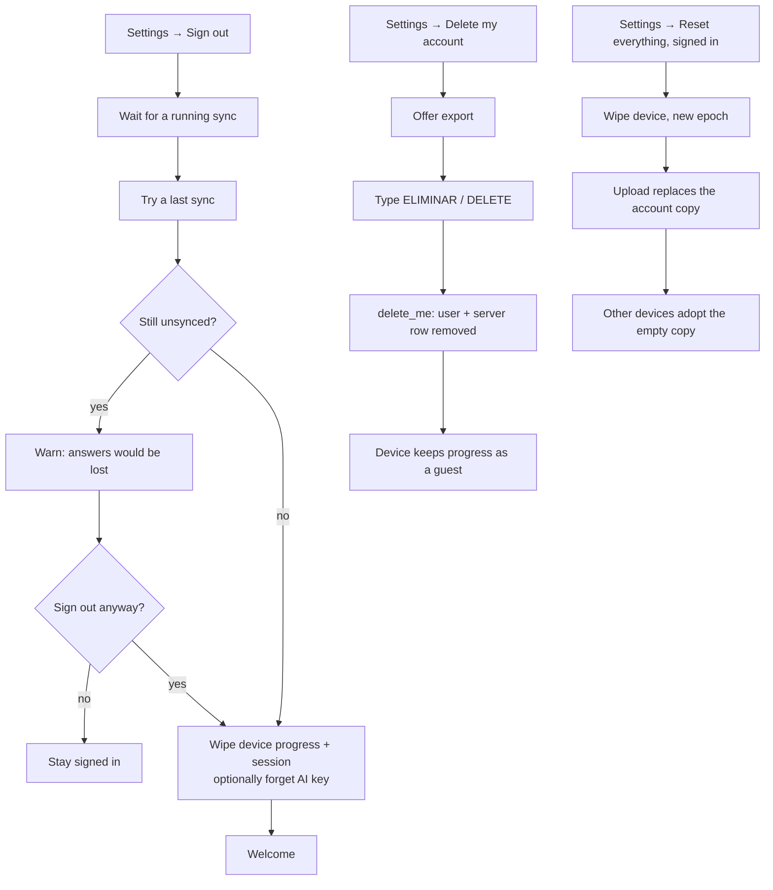

# 04 · User flows

_2026-11-13 · Status: current. Diagrams are Mermaid (GitHub renders them)._

## 1. App map

## 2. First run (CUJ-1, CUJ-2)

## 3. Daily practice: one session (CUJ-3, CUJ-5)

## 4. Goal setting and the weekly check (CUJ-7, CUJ-8)

## 5. Sign in: email code or Google (CUJ-15, 17, 18)

## 6. Background sync

## 7. Sign out and delete (CUJ-19, CUJ-20)

