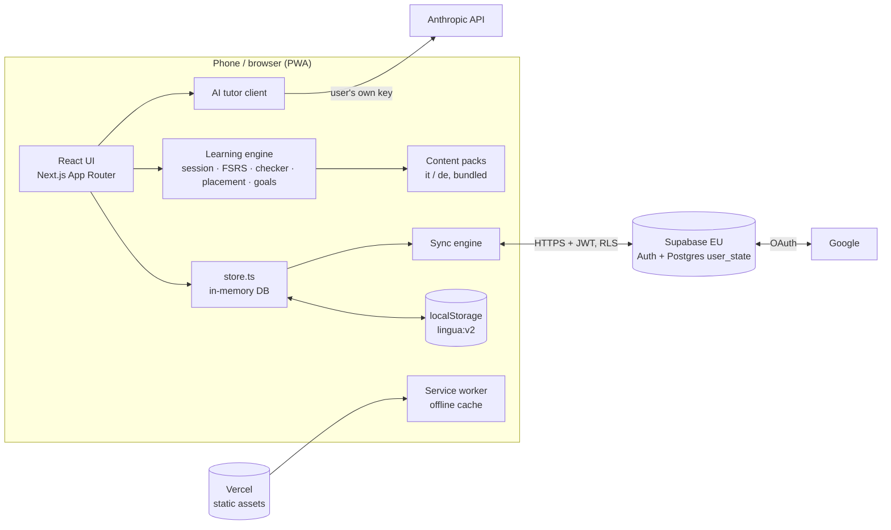

# 06 · Architecture

_2026-11-13 · Status: current (main + `accounts-sync`), revised after the Uber TL review the same day. Deeper rationale: docs/team/04-engineering.md (learning engine, LLM layer) and 40/42-accounts-* (sync, security)._

## 1. Shape of the system

Lingua is a **local-first, client-only web app**. All learning logic runs in the browser. The only servers are static hosting (Vercel) and, when the owner turns accounts on, Supabase (sign-in plus one Postgres table). There is no backend code of our own.



**Why this shape:** zero running cost, works offline by construction, nothing to patch, and the same bundle can later be wrapped in Capacitor without a rewrite (Strategy §7).

## 2. Tech stack

| Layer | Choice | Notes |
|---|---|---|
| Framework | Next.js 16 App Router, React 19, TypeScript | `cacheComponents` on. Pages are client components; no server actions or request-reading route handlers |
| Memory model | `ts-fsrs` (FSRS), desired retention 0.90 (0.85 for Maintain) | Behind a `schedule()` interface |
| Accounts | `@supabase/supabase-js` 2.118.0 (pinned) | Browser-only client, no cookies, PKCE flow |
| AI tutor | `@anthropic-ai/sdk`, lazy-loaded, model `claude-haiku-5-5` | Called from the browser with the user's own key |
| Offline | Hand-written `public/sw.js` | Cache-first static, network-first pages with cache fallback, route precache |
| Hosting | Vercel (Hobby) | Every push builds a preview; `main` deploys production |
| Tests | Vitest (unit + evals), Playwright (e2e) | `npm run eval` scoreboard with a quality bar |

## 3. Code map

```
src/
  app/                    routes: / (Today), /path, /me, /me/settings, /me/settings/tutor, /me/words,
                          /lesson, /placement, /onboarding, /account; layout mounts <Boot/> and <SyncRunner/>
  components/             TabShell, ui (buttons, sheets, headers), lesson/{Exercises,Feedback,Results},
                          Placement, GoalPicker, Boot (load + migrate DB), SyncRunner (sync triggers)
  content/                schema.ts (frozen contract) · it/ and de/: u01–u06, placement (30 items), lexicon
  lib/
    model.ts              DB types (Profile, CardV2, ReviewLog, Session, AppEvent…), caps
    storage-adapter.ts    the only place that touches localStorage (KEYS, localAdapter, memoryAdapter)
    store.ts              in-memory DB, update()/replaceDB()/resetDB(), onCommit listeners, useDB()
    migrate.ts backup.ts  v1→v2 migration; export/import with preview
    scheduler.ts          FSRS wrapper, rating map, 04:00 roll, seeded cards, v1 replay
    session.ts            session builder, interleaving, requeue, mode ladder, difficulty controller
    check.ts              deterministic answer checker
    placement.ts          Rasch/EAP adaptive test, unit mapping, seeds
    goals.ts stats.ts     goal maths; Today/Me numbers, weekly check, tester stats
    speech.ts feel.ts     TTS + speech; haptics/sounds
    i18n.ts nav.ts        UI strings es/en; route helpers (per-visit nonces)
    llm/                  provider (key storage, calls), guardrails (raise-only), tutor (cache, breaker)
    sync/                 merge (pure), engine (state machine), remote (Supabase + memory fake), client (browser wiring)
supabase/schema.sql       table, RLS policies, RPCs
public/sw.js              service worker
tests/                    unit tests; tests/evals/{checker,engine,content,ux,sync,e2e}
```

**Boundaries that matter:** content is imported only through `@/content`; storage only through `storage-adapter.ts`; Supabase only through `sync/client.ts` and `sync/remote.ts`; the AI key only through `llm/provider.ts`. Static evals enforce several of these.

## 4. Data model

One JSON document per device, `lingua:v2`:

```ts
DB = {
  version: 2,
  profile:  { appLang, activeLang, anchor, settings, onboarded, updatedAt,
              courses: { [it|de]: { explainIn, goal, placement, unit, addedAt } } },
  cards:    { [itemId]: CardV2 },        // FSRS state per item: due, stability, difficulty, reps, last_review…
  reviews:  ReviewLog[],                 // every graded answer (cap 20 000)
  sessions: Session[],                   // start/end, minutes, language
  custom:   Item[],                      // the user's own words
  events:   AppEvent[]                   // on-device metrics (cap 10 000), never uploaded
}
```

Sync-only fields (optional, ignored by guests): `epoch` (changes when the learner deliberately replaces everything) and `deleted` (tombstones: course language or custom-word id → when it was removed).

Other keys: `lingua:llm` (AI key: never backed up, never synced) · `lingua:llm-cache` · `lingua:v1-backup` · `lingua:auth` (Supabase session) · `lingua:sync` (rev, last sync, dirty) · `lingua:pre-login-backup` (copy taken before the first sign-in changes anything).

## 5. The learning engine

| Piece | How it works |
|---|---|
| **Session builder** | 5-minute chunks of ~22 tasks (4.4 tasks/min). Due reviews first (≤ 15/chunk, ≤ 40/day), then new items in unit order (base 5 per chunk), each introduced with "guess" and recalled 3–6 tasks later. Interleaved by type. A lesson keeps adding chunks (≤ 8) until the chosen minutes have passed |
| **Controller** | Rolling accuracy over the last 10 graded tasks: > 90% → +1 new and a harder mode; < 70% → −2 new and an easier mode |
| **Mode ladder** | recognize → tiles / article / listen → recall (typed); promoted when stability ≥ 3 days |
| **Scheduler** | FSRS without short-term steps or fuzz. Rating: wrong → Again; almost or "guessing" → Hard; right → Good; right + "sure" → Easy. Any due ≥ ½ day rolls to 04:00 local (sleep consolidation). Speed rounds never reschedule |
| **Checker** | Normalise → exact/accepted/variants → known errors → language rules (accents, umlauts, ß, elision, contractions) → closed-class words exact → typo tolerance on open-class words only (Levenshtein 1 at ≥ 5 letters, 2 at ≥ 10), never across a minimal pair |
| **Placement** | Rasch model, EAP on a 61-point grid, prior from self-report (sd 1.2). Next item = nearest difficulty, rotating skills. 8–15 items, stop at SE < 0.45. θ maps to a start unit; earlier units are seeded as "probably known" (stability 7 days) |
| **Goals** | Hours to level (A1.1 45 · A1 90 · A2 190 · B1 375) × pair multiplier (es→it 0.7 · en→it 1.0 · en→de 1.25 · es→de 1.3), minus class hours, spread over weeks × practice days, rounded up to 5, clamped 5–90 |
| **AI tutor** | Only for typed answers that are almost/wrong, online, 6 s timeout, 500-entry cache, 60 s circuit breaker. Guardrails accept a structured grade and can raise by one step only, never to Easy, never lower. Output rendered as plain text |

## 6. Offline and installability

`manifest.ts` makes it installable. The service worker precaches every route on install, serves `/_next/static`, fonts and icons cache-first, and pages network-first with a cache fallback (so an offline cold start opens the last-seen page or Today). Cross-origin requests (Supabase, Anthropic, Google) are never cached. The cache version (`lingua-v2-2`) is bumped whenever routes change. `navigator.storage.persist()` is requested on first run.

## 7. Accounts and sync

### 7.1 Sign-in
- **Email code:** `signInWithOtp({ email, shouldCreateUser: false })` → user types the 6-digit code → `verifyOtp(type "email")`. A typed code, not a magic link, because on iOS a link opens Safari, whose storage is separate from the installed app.
- **Google (optional, `NEXT_PUBLIC_AUTH_GOOGLE=1`):** `signInWithOAuth({ provider: "google", redirectTo: <origin>/account?from=… })` with the **PKCE** flow. Google → Supabase → back to `/account?code=…`. The page exchanges the code (the verifier never left this browser), strips it from the URL with `history.replaceState`, then continues exactly like the email path. Errors come back as `?error=…`; `signup_disabled` maps to "not invited".
- **Invite-only:** sign-ups are off in Supabase. The owner adds a user by email; that user can sign in by email code, or by Google with the same address (Supabase links the Google identity to the existing user because Google verifies the email). Any other Google account is refused by Supabase.
- The Supabase session lives in `lingua:auth` through the storage adapter (no cookies, `detectSessionInUrl: false`).

### 7.2 Server schema (`supabase/schema.sql`)
- `user_state(user_id uuid PK = auth.uid(), db jsonb, rev bigint, updated_at, device)`, `on delete cascade` from `auth.users`, `pg_column_size(db) < 4 MB`.
- RLS on; `anon` has no access. Select/insert/update policies `to authenticated using (user_id = auth.uid())`. No delete policy.
- `push_state(expected_rev, doc, device)`: SECURITY INVOKER (RLS applies), insert when `expected_rev = 0`, otherwise update only if `rev` matches; returns the new rev or −1.
- `delete_my_state()` and `delete_me()`: SECURITY DEFINER with `search_path = ''`, scoped to `auth.uid()`.

### 7.3 Sync engine (`src/lib/sync/engine.ts`)
- **One document per user** with optimistic concurrency on `rev`. The server row is **never deleted** while the account exists, so `rev` only increases (a restarted rev could make a device skip a merge).
- **Triggers** (SyncRunner): app open, `online`, app visible/hidden, end of every lesson (Results), at most every **2 minutes** while practising, and "Sync now". Triggers start as soon as the engine has finished the first sign-in (no restart needed). Calls are serialized; a version counter notices edits made during an upload.
- **Conflict:** push fails (−1) → pull → `mergeDB(local, remote)` → push against the remote rev; up to 4 rounds.
- **`mergeDB` rules (pure):** reviews = union keyed by time|item|mode, capped at the newest 20 000 · sessions = union · cards: later `last_review` wins, then more reps, then local (if the same word was reviewed on two devices while both were offline, the review *log* keeps both answers but the schedule follows the later one) · profile: last writer wins on `updatedAt` (device clocks) · courses merged per language by their latest stamp · custom words: union · **tombstones** (`deleted`): a removed course (with its cards) or custom word stays removed unless the course was added again later · fields this build doesn't know are kept, never dropped. `events` and legacy ties never upload.
- **Starting over (epoch):** Reset everything, importing a backup, and "Use this device" stamp a new `epoch` and set `replace`: the next upload overwrites the server copy instead of merging. A device that pulls a document with a different epoch **adopts** it (keeping its own on-device events) instead of merging, so the old progress can't come back from another phone. Unsynced answers on that other device are dropped; this is the meaning of "start over".
- **Format gate:** a server document with `version` above what this build knows (`KNOWN_FORMAT = 2`) sets status `outdated` ("Update Lingua to keep syncing") and this device never writes over it.
- **First login** on a device returns uploaded / downloaded / empty / same / choose; "choose" offers Combine (merge) / Use account / Use device. If the device already had progress, a copy is saved as `lingua:pre-login-backup` first. There is no button to restore it yet, and sign-out removes it (tech debt §12).
- **Sign out** waits for any running sync, tries a final sync, refuses (unless forced) if still dirty, then wipes the device. A server answer that arrives after sign-out is discarded (generation counter), so nothing lands on the wiped device.

## 8. Security and privacy

| Threat | Control |
|---|---|
| Another user reads my progress | RLS policies on `auth.uid()`; anon revoked; definer functions scoped to the caller |
| A stranger signs up | Sign-ups disabled server-side; `shouldCreateUser: false` client-side; Google sign-in refused for unknown emails |
| Stolen OAuth code | PKCE: the code is useless without the verifier stored only in this browser; redirect only to the app's own origin (allow-listed in Supabase). Returning to a different browser shows "use your email code"; a stray `?code` on any other page is handed to `/account` and removed from the URL |
| A policy mistake leaks another row | Queries also filter `user_id = me` (defence in depth); the table's default privileges are revoked and only select/insert/update granted; no DELETE |
| Injected script exfiltrates the session or AI key | Page CSP: `connect-src 'self' <supabase> https://api.anthropic.com`, `object-src 'none'`, `frame-ancestors 'none'`, `base-uri 'self'` |
| Secrets in the bundle | Only the public URL and anon key are read from env (static eval). No `service_role`, no Google client secret anywhere in the app (eval) |
| AI key leaks | Stored in `lingua:llm` only; excluded from backups and sync payloads; sync code may not reference it (eval); e2e asserts no request body contains `sk-ant-` |
| XSS via tutor text | LLM output rendered as plain text |
| Admin visibility | Disclosed before sign-in; data in the EU region; delete-account in-app |

## 9. Testing and quality

| Layer | What | Count (last run) |
|---|---|---|
| Unit | `npm test` (vitest) | 178 |
| Evals (vitest) | checker 255, engine 163, content 46, content-audit 391, ux-static, sync 150 (merge, engine, privacy) | see scoreboard |
| E2E | Playwright on production builds at 390×844: `cuj.spec` 15 and `ux.spec` 19 (port 3500); `account.spec` 11 (port 3510, built with a fake Supabase URL answered in-test by `page.route`) | 45 |
| Bar | ≥ 99% overall, each category ≥ 95%, 0 open P0/P1 (`tests/evals/issues.json`) | `npm run eval` prints the current total |

**What the fake hides:** the e2e Supabase is a hand-written fake. It doesn't enforce RLS, grants, the 4 MB cap or real PKCE verification. Those are covered only by the manual check in `docs/setup-accounts.md` step 10 until a local Supabase + pgTAP test exists (§12).

**Not automatable:** a real Supabase project (RLS check is a manual step in the setup guide), Google on a real iPhone, iOS install and storage eviction, real TTS voices, a live Anthropic key.

## 10. Build, deploy, configuration

- `NEXT_DIST_DIR` chooses the build folder so several builds can coexist on the owner's Mac (v1 on :3200, v2 on :3201, QA on :3500/:3510).
- Vercel environment variables (Production + Preview), all public by design: `NEXT_PUBLIC_SUPABASE_URL`, `NEXT_PUBLIC_SUPABASE_ANON_KEY`, `NEXT_PUBLIC_AUTH_GOOGLE` (`1` to show Google). They are baked in at build time, so changes need a redeploy.
- Secrets that exist but never touch the app: the Supabase `service_role` key and database password (owner's password manager), the Google OAuth client secret (pasted only into Supabase), the Gmail app password (only in Supabase SMTP).

## 11. Capacity, failure modes and data lifecycle

**Capacity math.** One review log entry is ~140 bytes of JSON. A daily 15-minute learner makes ~60 graded answers a day ≈ 22 000 a year, so a heavy user reaches the 20 000-review cap (≈ 2.8 MB document) in about a year; the oldest reviews are then dropped from the synced document. Postgres stores jsonb compressed, under the 4 MB `pg_column_size` check. Uploads happen at lesson end and at most every 2 minutes, so a 15-minute day costs ~8 uploads; at 20 users that is far inside the Supabase free tier.

| Failure | What the user sees | What happens to data |
|---|---|---|
| Offline / server down | "Offline — will sync later" or "Couldn't sync — will retry" | Kept on device, uploaded later |
| Supabase free project paused (after ~7 idle days) | "Couldn't sync — will retry" | Kept on device. The owner gets an email and clicks Restore; paused projects can only be restored for a limited time (check the Supabase dashboard), so restore promptly |
| A newer app wrote the server copy | "Update Lingua to keep syncing" | This device never overwrites it |
| Server document unreadable | "Your account's progress couldn't be read…" | Nothing on the device is changed |
| Document over 4 MB | "Couldn't sync" (no specific message yet, §12) | Kept on device |
| Session expired after long offline | Settings shows signed out | Device data kept; signing in again merges |

**Data lifecycle.** Created on first upload · updated by every sync (never deleted while the account exists) · "Reset everything" uploads an empty document with a new epoch · "Delete my account" deletes the auth user and, by cascade, the row · the owner can delete a user in the dashboard (same effect) · no server-side backups on the free plan (§12).

**Format policy.** Never change the meaning of an existing field. New fields are optional and ignored by old builds (merge keeps unknown fields). A breaking change bumps `DB.version`; older builds then show "Update Lingua" and stop writing. Bump `public/sw.js` VERSION in the same release so installed apps pick up the new build quickly.

## 12. Decisions (ADR summary)

| Decision | Alternatives rejected | Why |
|---|---|---|
| Client-only app, no backend | Next server routes; Firebase functions | €0, offline by construction, Capacitor-ready |
| Supabase (Auth + one table) | Firebase, Clerk + Postgres, custom | One vendor, EU region, RLS, free tier |
| Email **code**, not magic link | Magic link; passwords | iOS opens links in Safari, separate from the installed app |
| One document per user + `rev` | Per-card rows, CRDT | Simple and fast enough at this scale; revisit past ~20 users |
| Epoch + tombstones | Deleting the row on reset | Deleting restarted `rev` and let other devices resurrect data |
| Google behind a flag, PKCE | Implicit flow; always on | Production unchanged until the owner sets up OAuth; codes are useless if intercepted |

## 13. Known limits and tech debt

1. Whole-document sync: fine to ~20 users; beyond that, send deltas or move to per-card rows.
2. **No server backups** on the free plan. Next: a `prev_db` column written inside `push_state` (one-step undo) or a scheduled `pg_dump`.
3. **No real-Postgres test of RLS/grants/`delete_me`.** Next: Supabase CLI locally + pgTAP (B can't read or update A's row; anon denied; definer functions touch only the caller).
4. **Several tabs** each run their own engine; a second tab could upload after the first signs out. Next: `navigator.locks` + `storage` events on `lingua:sync`/`lingua:auth`.
5. **Different account after a session expiry:** the previous person's device data is offered to the new account. Next: if the stored sync user differs, back it up and start the new account clean.
6. **Pre-login backup** has no restore button, doubles storage (Safari allows ~5 MB), and is removed on sign-out. Next: restore button or move to IndexedDB; check `set()` results.
7. **Clock skew:** profile and card merges trust device clocks. Recomputing a card's schedule from the merged review log would be exact.
8. **Observability:** sync errors show only in Settings. Next: a saved SQL query (`updated_at`, `device` per user) for the owner and a small error badge outside Settings.
9. No specific message for "document too large".
10. Lint exception: one `exhaustive-deps` disable on the account page (the Google return must run once).
11. The content contract (`schema.ts`) is frozen; adding exercise types needs a decisions entry.
